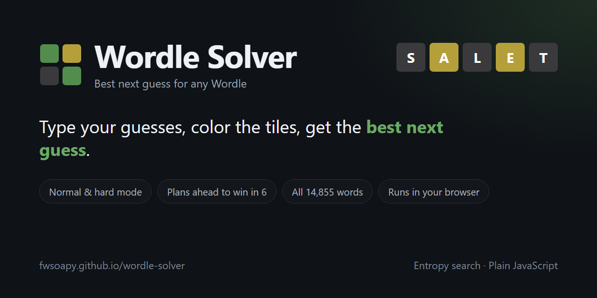

# Wordle Solver

**[Open the solver](https://fwsoapy.github.io/wordle-solver/)**

Type the guesses you made in Wordle, tap the tiles to match the colors you got, and it tells you the best word to guess next. Works on phones and computers, in normal and hard mode.



## How to use it

1. Type your first guess. Use your keyboard or the one on the page.
2. Tap each tile until it matches the game: once for yellow, twice for green.
3. Hit **Calculate Best Guess**.
4. Tap **Use this guess** to drop the word into the next row, then color it after you play it.

No guesses yet? It starts you with SALET.

## How it picks a guess

- **Only words that fit.** It keeps every word that still matches all your colors, including tricky repeated letters like the two E's in SPEED.
- **Common words first.** Wordle accepts 14,855 words, but the answer is almost always a normal word. It plans around the common ones and only falls back to rare words when nothing common fits.
- **Most information.** For each possible guess it works out how the leftover words would split up by color. The guess that splits them most evenly tells you the most, so it wins.
- **Looks ahead.** Before suggesting a word it checks that it can still win in the guesses you have left, whatever the answer is. If no word can promise that, it picks the one that wins for the most answers.
- **Real hard mode rules.** Greens stay where they are and every yellow gets used again.

The second guess after SALET is worked out ahead of time for every color pattern (`book.js`), so it shows up instantly. Later guesses are searched live in the browser, with a 2 second cap so the page never hangs.

## Results

`test.js` plays 300 games against common words, starting from SALET:

| Mode | Won | Average guesses |
|---|---|---|
| Normal | 300 of 300 (100%) | 3.81 |
| Hard | 298 of 300 (99.3%) | 3.87 |

Hard mode can't win every time. With words like _OUND or _ATCH there can be more answers left than guesses, and hard mode won't let you burn a guess on a word that tests several letters at once.

## Run it yourself

It's one HTML file with no build step and no dependencies. Open `index.html` in a browser.

```bash
node test.js        # color logic, filtering and 300 full games
node book.js        # rebuild the precomputed second guesses
```

## License

MIT
